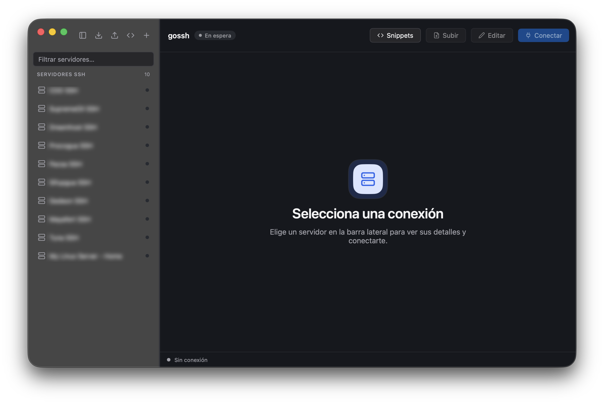
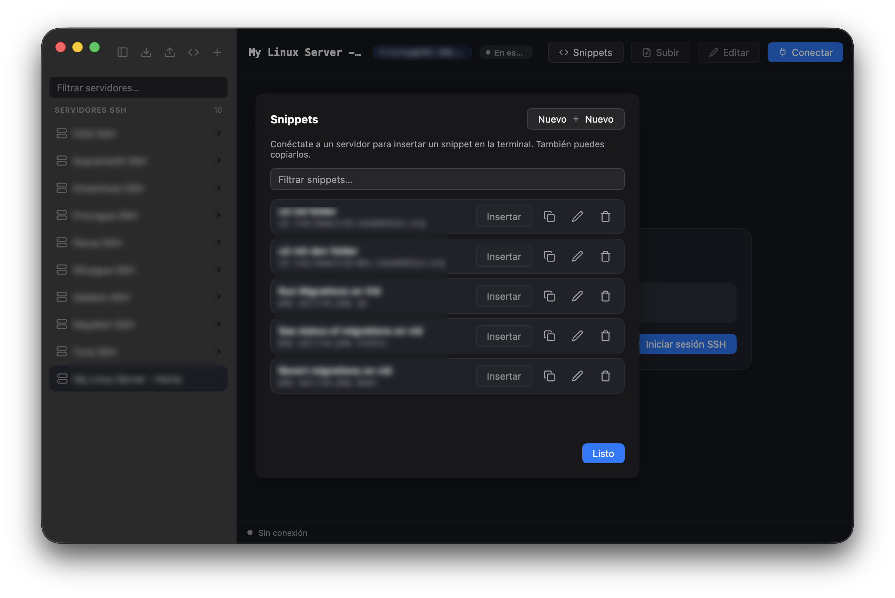
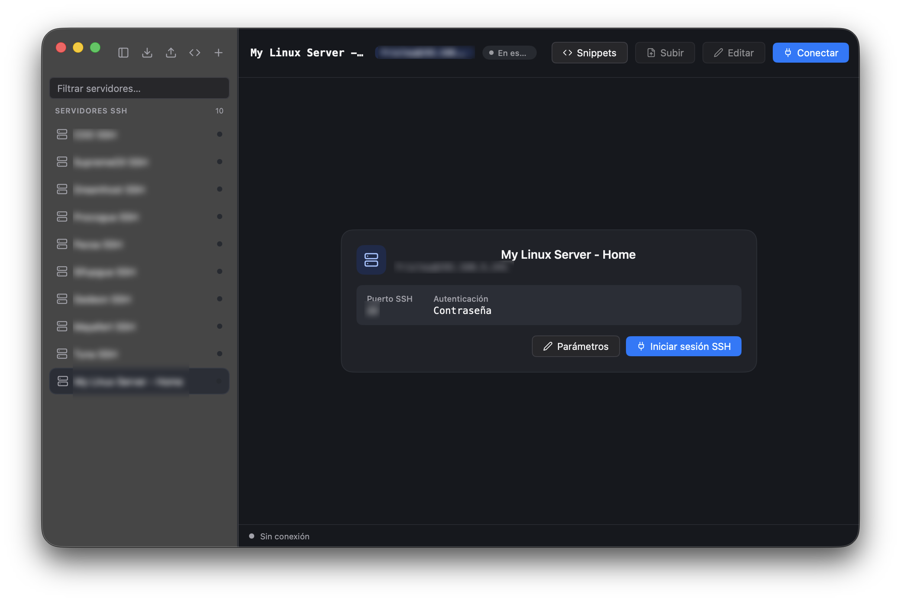
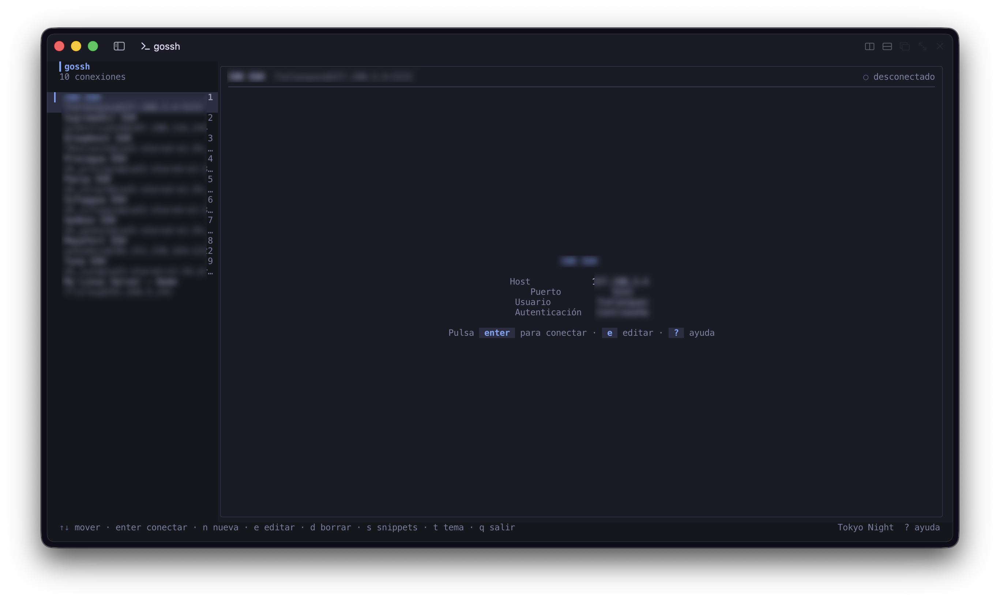
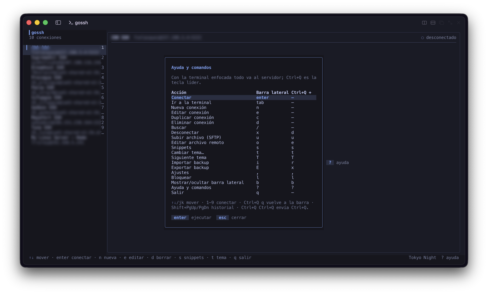

# gossh — gestor SSH

Gestor de conexiones SSH con terminal embebida, hecho en Go. Son **dos apps, ambas llamadas gossh**, con las mismas
funciones y el **mismo almacén cifrado** (`~/Library/Application Support/gossh/`, clave en el Llavero de macOS):
tus conexiones, snippets y backups sirven en las dos.

| Proyecto | Qué es | Stack |
|---|---|---|
| [`goapp/`](goapp) | **gossh**, app de escritorio nativa para macOS | Go + [MyGo](https://mygo.egoist.dev) |
| [`gossh-cli/`](gossh-cli) | **gossh CLI**, versión de terminal (binario `gossh`) con temas | Go + Bubble Tea + Lip Gloss |

## Funciones (en ambas)

- Conexiones: crear, editar, duplicar, eliminar y buscar.
- Terminal SSH interactiva real (vim, htop, tmux…), con redimensionado y keepalive.
- Autenticación: contraseña, llave privada (con/sin passphrase), keyboard-interactive (OTP/2FA) o combinaciones.
- Verificación de host keys contra `~/.ssh/known_hosts`.
- SFTP: subir archivos y editar archivos remotos.
- Snippets cifrados para pegar en la sesión.
- Backup export/import cifrado con contraseña (Argon2id + AES-256-GCM), incluye snippets.
- Seguridad opcional: Touch ID para conectar y bloqueo al abrir.

La CLI añade **16 temas** (Tokyo Night, Dracula, Catppuccin, Nord, Gruvbox, Solarized, One Dark, Rosé Pine,
Kanagawa, Monokai, GitHub Light…) con selector y vista previa en vivo (`t`), `gossh --theme NOMBRE` y
`gossh theme list|set|current`.

## Screenshots
### GUI




### CLI TUI




## Empezar

```bash
# App de escritorio
cd goapp && go run .              # o ./build/dmg.sh para generar el .app/.dmg

# CLI
cd gossh-cli && make build        # → dist/gossh
./dist/gossh                      # ? dentro de la app muestra todas las teclas
```

Cada proyecto tiene su README con teclas, seguridad y desarrollo:
[`goapp/README.md`](goapp/README.md) · [`gossh-cli/README.md`](gossh-cli/README.md).
Documentación técnica en [`docs/`](docs) y [`goapp/docs/`](goapp/docs).
